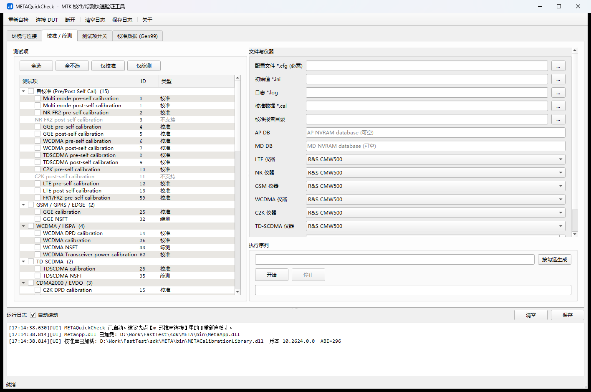

# METAQuickCheck

MTK 模块（工厂机 / 工程样机）的校准与综测快速验证工具。

界面是 Qt5，算法全部在 MTK 官方的 SDK库 里；本工具只负责把它的
公开 C 接口驱动起来并显示结果，不实现任何校准逻辑。



## 快速开始

> 本仓库**不含 MTK 的 META SDK**（头文件与 DLL 不随仓库分发）。
> 要真正构建并连接模块，需要 MTK 授权提供的 META SDK。

```bat
build.bat D:\Qt5\5.14.2\msvc2017 clean
build\bin\METAQuickCheck.exe --selftest
build\bin\METAQuickCheck.exe
```

自检最后一行出现 `结果: 通过 (0 个致命问题)`、且 `ABI = 296`、`已解析 14 / 缺失 0`，说明环境正常。

## 环境要求

| 项 | 要求 |
|---|---|
| 架构 | **必须 Win32 (x86)**。META 的 DLL 全是 32 位，`CMakeLists.txt` 会拦住 64 位编译 |
| Qt | 5.14.2 `msvc2017` **32 位**，例如 `D:\Qt5\5.14.2\msvc2017` |
| Visual Studio | 2019（16.x），或 2022 + v142 工具集。`build.bat` 自动探测，没有 2019 就用 `2022 -T v142` |
| CMake | ≥ 3.16 |

机器上如果同时装了 Qt6，`windeployqt` 会被 PATH 里的 `qmake` 带到 Qt6 目录而失败；
`build.bat` 已经把 Qt5 的 `bin` 前置到 PATH，`CMakeLists.txt` 里那条 windeployqt 也单独注入了 PATH，不用改。

## 用法

四个标签页按顺序走：

1. **环境与连接** — 确认 DLL 加载、库版本、ABI、导出解析数量；连接 DUT（自动扫描 / 指定串口 /
   已在 META 模式），可选继续 AP→Modem。
2. **校准 / 综测** — 左侧按制式分组勾选测试项（74 个），右侧填 `*.cfg` / `*.ini` / 日志 /
   校准数据路径和 6 类制式的仪器型号；勾选结果自动生成执行序列，也可以手工改写。
3. **测试项开关** — 192 个 bool 子项开关，按 28 个分组浏览/搜索，支持本组全开/全关。

命令行：

```bat
METAQuickCheck.exe --selftest [--dir <META 运行时目录>]   :: 环境自检（控制台 + 文本报告）
METAQuickCheck.exe --tab 2 --size 1400x900              :: 启动直接定位标签页 / 指定窗口尺寸
```

## 返回值

| 现象 | 原因 / 处理 |
|---|---|
| 连接返回 `4` | 找不到 Preloader 口：模块没断电重启 / USB 线 / MTK 驱动 / 超时太短 |
| 连接返回 `14` / `15` | AP / MD DB 不匹配，端口已拿到，工具按可继续处理 |
| 点「开始」立刻失败 | 检查 `*.cfg` 是否存在、序列是否为空、对应分组子开关是否打开 |
| 跑完没有任何日志 | `*.cfg` 里的 `log_path` 没能建出 logger 时，DLL 的日志回调一条都不会来 |

## 目录结构

```
CMakeLists.txt          定位 Qt5 / sdk/META，烘焙 MQC_RUNTIME_DIR，构建后跑 windeployqt
build.bat               一键构建（自动选 VS 生成器）
pack.bat                打包（slim=源码+头文件，full=再带运行库与构建产物）
src/
  main.cpp              入口 + --selftest
  CalTypes.h            纯 C++ 数据类型（不含 Qt / META 头）
  CalBridge.h/.cpp      唯一 include METACalibrationLibrary.h 的 TU：动态加载、开关表、执行
  MetaSession.h/.cpp    唯一 include MetaApp.h 的 TU：连接 / AP→Modem / 断开
  LogBus.h/.cpp         线程安全日志总线
  MainWindow.h/.cpp     四个标签页 + 日志 + 工作线程
  Theme.h/.cpp          字体、日志等宽、表头底色（其余用 Qt 默认样式）
  gen/FlagTable.inc     192 个开关 → offsetof 偏移（自动生成，**不进仓库**）
  gen/TaskCatalog.inc   74 个测试项 + DLL 是否实现（自动生成，**不进仓库**）
tools/gen_tables.py     解析官方头文件/源码生成上面两张表
sdk/META/               自己放 MTK 的 SDK 用：include/（头文件）+ bin/（运行库），**不进仓库**
```

## 说明

- 本工具不含任何校准算法；测量与数据都来自 MTK 官方库。
- `sdk/META/` 下的头文件与运行库版权归 MTK，不随本仓库分发。
- 单 DUT、无工位管理 / MES / 良率统计，定位是工程师现场快检与排障。
